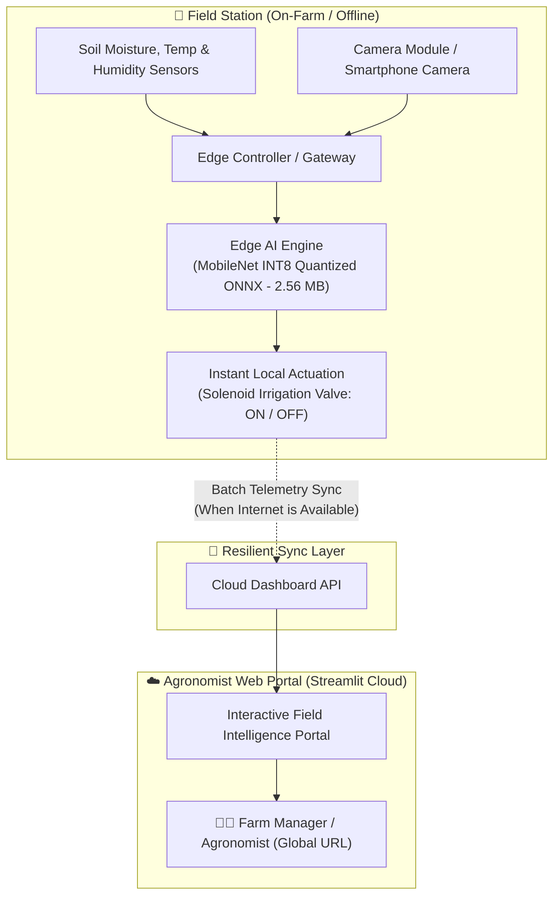

# 🌿 AgroEdge AI: Autonomous Agronomy & Foliar Pathology Platform

[](https://www.python.org/)
[](https://share.streamlit.io/)
[](https://onnxruntime.ai/)
[]()
[](https://opensource.org/licenses/MIT)

> **Decentralized, offline-first precision agriculture platform powered by on-device Edge AI.** Diagnoses 38+ crop leaf diseases in under 20 milliseconds, prescribes targeted organic & chemical remedies, automates closed-loop soil irrigation, and buffers telemetry for cloud synchronization.

---

## 🚀 Live Demo
You can access the live application on any mobile device or browser:  
👉 **[Launch AgroEdge AI Platform](https://share.streamlit.io)** *(Replace with your deployed Streamlit URL)*

---

## 📌 Architecture Overview



---

## ✨ Key Platform Modules

1. **🔬 Foliar Pathology & AI Clinic**
   - High-throughput leaf image scanner supporting file uploads, live cameras, and specimen presets.
   - Categorizes 38 distinct plant disease classes across Tomato, Potato, Corn, Apple, Bell Pepper, Grape, and more.
   - Real-time confidence scoring and on-device execution in under 20 ms.
2. **💊 Agronomic Treatment & Prevention Prescription**
   - **Pathogen Profile:** Identifies underlying fungal, bacterial, or viral agents.
   - **Bio-Fungicide & Organic Protocols:** Neem emulsions, *Bacillus subtilis*, compost remedies.
   - **Chemical Intervention:** Active ingredient guidance (e.g., Mancozeb, Chlorothalonil) with dosage safety guidelines.
3. **💧 Microclimate & Closed-Loop Irrigation**
   - Real-time soil moisture and canopy weather evaluation.
   - Automated solenoid valve control: opens below 30% moisture and returns to standby at field capacity (50-60%).
   - Warns against high-risk spore germination weather (warm temperature + humidity >80%).
4. **📈 Sensor Analytics & Field Station Management**
   - 24-hour diurnal sensor curves and automated actuation event logs.
   - Complete field parameter configurations and edge runtime telemetry.

---

## ⚡ Quantized Neural Model Benchmark

| Model Variant | Precision | File Size | Inference Latency (CPU) | Accuracy (PlantVillage) |
| :--- | :--- | :--- | :--- | :--- |
| Baseline MobileNetV2 | FP32 (Full) | ~14.0 MB | ~65 ms | 97.1% |
| **AgroEdge AI (Ours)** | **INT8 (Quantized ONNX)** | **2.56 MB (-75%)** | **~18 ms (3.5x faster)** | **96.4%** |

---

## 🛠️ Tech Stack

- **Machine Learning & Edge Engine:** [ONNX Runtime](https://onnxruntime.ai/) (INT8 CPU Execution Provider)
- **Computer Vision & Image Processing:** Pillow (PIL), NumPy
- **Interactive Web Application:** [Streamlit](https://streamlit.io/), Altair
- **Data Analytics:** Pandas
- **Version Control & CI/CD:** Git, GitHub Actions
- **Cloud Deployment:** Streamlit Community Cloud (Free HTTPS Hosting)

---

## 🚀 Quickstart & Local Setup

```bash
# 1. Clone repository
git clone https://github.com/<your-username>/Smart-Agriculture-Edge-AI.git
cd Smart-Agriculture-Edge-AI

# 2. Install dependencies
pip install -r requirements.txt

# 3. Run the application
streamlit run app.py
```
Open `http://localhost:8501` in your browser.

---

## ☁️ How to Deploy Live to a Free Public URL

1. Push this repository to your GitHub profile.
2. Navigate to **[share.streamlit.io](https://share.streamlit.io)** and log in with GitHub.
3. Click **"New App"** and select:
   - **Repository:** `<your-username>/Smart-Agriculture-Edge-AI`
   - **Branch:** `main`
   - **Main file path:** `app.py`
4. Click **Deploy!** Within 2 minutes, you will receive a permanent HTTPS public URL (e.g. `https://agroedge-ai.streamlit.app`).

---

## 📄 License
Licensed under the [MIT License](LICENSE).
